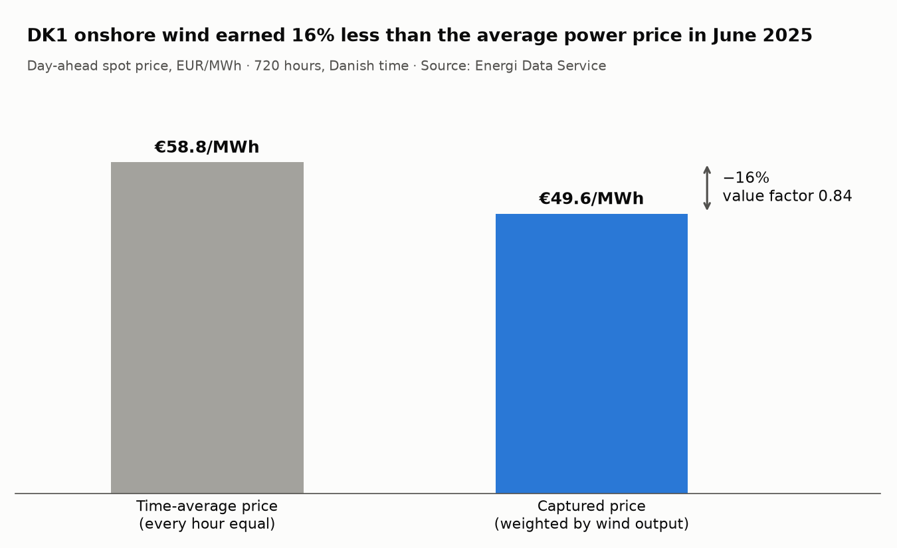

# WindEtAl

Wind energy × electricity-market analysis. Ports-and-adapters monorepo:
`apps/ → modules/ → libs/core`, dependencies point inward only, and `libs/core` does no I/O.

---

## M1 — DK1 onshore wind value factor, June 2025



### Question

Which Danish bidding zone is best for wind *on revenue*, not on wind resource? Wind
output and power price move against each other. Windy hours are windy across the
whole zone, so cheap wind floods the merit order and the price falls exactly when a
turbine produces most. A windier site can therefore earn less per MWh than a calmer
one. M1 is the thinnest slice of that question: one zone (DK1), one month (June 2025),
one number.

### Method

```
captured price     = Σ(price_h × output_h) / Σ(output_h)
time-average price = Σ(price_h) / N
value factor (VF)  = captured price / time-average price
```

- **Prices:** Energi Data Service `Elspotprices`, DK1, `SpotPriceEUR` (EUR/MWh).
- **Output:** Energi Data Service `DeclarationProduction`, DK1, `WindOnshore`,
  `FuelAllocationMethod = All`, `Version = Final`.
- **Window:** June 2025 in Danish time, i.e. `HourUTC` 2025-05-31T22:00 → 2025-06-30T21:00,
  720 hours. `HourUTC` is the canonical timestamp.
- **Alignment:** price and output are joined on `HourUTC` in the domain
  (`PriceVolumeSeries.from_series`). Any hour present in only one series raises
  `MisalignedSeriesError`; nothing is filled, dropped, or inner-joined
  ([ADR 0002](docs/adr/0002-join-location.md)).
- **Architecture:** ports and adapters; `libs/core` is pure and stdlib-only
  ([ADR 0001](docs/adr/0001-ports-and-adapters.md)).
- The prediction was committed before any data was pulled
  ([m1-prediction.md](docs/decisions/m1-prediction.md)).

Reproduce: `uv run python -m scripts.m1_number` (live pull, writes the result file and the
chart). Tests: `uv run pytest` (offline).

`docs/adr/` holds architecture decisions; `docs/decisions/` holds M1's prediction and result.

### Result

| | Predicted | Actual |
|---|---|---|
| **Value factor** | 0.77 | **0.84** |
| Captured price | €32.7/MWh | €49.6/MWh |
| Time-average price | €42.3/MWh | €58.8/MWh |

DK1 onshore wind earned 16% below the average price in June 2025, despite 116
negative-price hours (16% of the month). The direction of the prediction was right, but
it overestimated cannibalization. A plausible reading, not yet tested, is that solar
rather than wind took most of the cheapest midday hours, so wind avoided the worst
prices more than expected. Full output: [m1-result.md](docs/decisions/m1-result.md).

### What failed

- **Shipped late.** The plan was to ship by 2026-10-06; it shipped on 2026-10-12. The
  prediction was still written and committed before any data was pulled.
- **The prediction model was too pessimistic.** It assumed windy hours clear near
  €25/MWh. The real gap between captured and average price was smaller.
- **The mapper was broken going into ship week, and nothing caught it.** It returned a
  class attribute instead of an instance and overwrote its input with `print()`. The
  design doc promised a fixture-backed mapper test that was never written; it would have
  caught both bugs offline. _Fixed before the tag; the test now exists._
- **The join was designed in August and built in the last session.** ADR 0002 settled it
  and specified its tests, but the first value-factor run aligned the series with inline
  asserts in the script instead. _Fixed before the tag._
- **Code that does not parse was committed.** A second, broken adapter
  (`modules/m1_data_analysis/adapters/energinet.py`) and an early sketch
  (`adapters/adapter_firstmodule.py`) sat next to the real adapter. _Deleted before the tag,
  with other leftovers._
- **The docs disagreed about what "June" means.** The design doc and data contract use
  Danish June; the `DateRange` docstring and the architecture notes used UTC June. Both are
  720 hours, so the row-count check cannot tell them apart: a two-hour shift would have
  produced a confident, wrong number. _Docs corrected before the tag._
- **Superseded decisions were not marked.** The architecture notes still said the domain
  trusts the adapter for alignment and listed the join as open, two months after the
  decision. _Marked superseded before the tag._
- **The live pull hit HTTP 429 (rate limit).** A retry a minute later succeeded. The design
  doc assigns rate-limit handling and error translation to the adapter; neither is
  implemented.
- **Two of the three planned charts were cut.** The design doc specifies three; M1 ships
  only captured vs. time-average.

### Carried forward

| Item | Why it is not in M1 |
|---|---|
| Adapter robustness: HTTP 429 back-off, HTTP errors translated into domain errors | Not needed for a one-off pull that succeeds; belongs with the second data source, when failures multiply |
| Charts 1 (prices vs. wind) and 3 (29 June close-up) | Descoped to protect the ship date. Chart 3's planned title is an unverified claim |
| Whether `modules/*/service.py` is justified, or the entry point calls core directly | Open design question; M1's entry point is `scripts/m1_number.py` |
